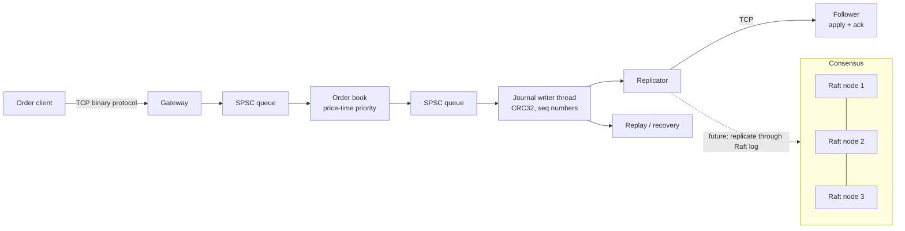

# Meridian by MANAS JAIN

A matching engine in C++20, built the way a trading firm would build one: every component has a design doc, a deterministic test, a fuzzer or a simulator, and a write-up that separates what was measured from what is only a hypothesis.

Status: work in progress (month 1 of a 12-month plan). Everything here is free to build and run; no paid services.

Technical report: Manas Jain, "Meridian: a test-first matching engine with Raft replication", Zenodo, 2026. [10.5281/zenodo.23856006](https://doi.org/10.5281/zenodo.23856006). It is a technical note, not peer reviewed.

Code archive (v0.1.1): [10.5281/zenodo.23937958](https://doi.org/10.5281/zenodo.23937958).

## Architecture



| Component | What it is | Header / source |
|---|---|---|
| Wire protocol | Fixed binary messages, explicit endianness | `include/meridian/protocol.hpp` |
| Order book | Fixed pool, intrusive FIFO per level, open-addressing id map, 64-ary bitmap for best price | `order_book.hpp`, `price_bitmap.hpp` |
| SPSC queue | Lock-free ring, acquire/release, cached opposite index | `spsc_queue.hpp` |
| Journal and replay | 32-byte records, CRC32, sequence numbers, one shared `apply()` | `journal.hpp`, `replay.hpp` |
| Journal writer | Dedicated thread, group commit | `journal_writer.hpp` |
| Replication | Leader/follower, batched cumulative acks, ack-before-apply | `replication.hpp` |
| Raft | Pure state machine (election, replication, pre-vote, CheckQuorum) plus a seeded cluster simulator | `raft_node.hpp`, `raft_sim.hpp` |
| Replicated state machines | Committed entries applied to an order book and to the full OMS | `raft_apply.hpp`, `raft_oms.hpp` |
| Order management | Accounts, idempotent order ids, risk limits, self-trade prevention, stop orders | `oms.hpp` |
| HTTP gateway | Loopback server over the OMS, with a React front end | `src/gateway.cpp`, `web-ui/` |

## Design decisions and tradeoffs

1. **Bitmap for best price instead of a scan or `std::map`.** A 64-ary bitmap finds the best price in a few word operations. Cost: memory proportional to the price range and a bounded tick grid. See `docs/bugs/007`.
2. **Fixed pool and intrusive lists, no heap on the book's hot path (intent).** Predictable latency, cache-friendly. Cost: a hard capacity limit. The "no allocation" claim is not yet proven by a test.
3. **SPSC queue instead of a mutex queue.** Compared in `docs/bugs/009`. Cost: exactly one producer and one consumer; fan-in needs a different design.
4. **Event sourcing with one shared `apply()`.** Live path and replay path run the same code, and an order-sensitive digest detects divergence. Cost: the journal format becomes a compatibility surface.
5. **Replication acks before apply and never beyond the first invalid record.** Cost: a follower can lag the leader's applied state. See `docs/bugs/013`.
6. **Raft as a pure state machine.** No clock, sockets or threads inside the node, so a deterministic simulator can inject loss, duplication, reordering, crashes and partitions from one seed. Cost: an I/O layer must be written later.
7. **Open-loop load generation.** Latency is measured from the intended send time to avoid coordinated omission.

Cost per operation, memory, the unbounded OMS maps and the scaling paths are in `docs/complexity-and-scaling.md` (from reading the code, not new measurements).

Cost per operation, memory, the unbounded OMS maps and the scaling paths are in `docs/complexity-and-scaling.md` (from reading the code, not new measurements).

## Testing approach

1. Unit tests for every component, including endianness and protocol edge cases.
2. Differential fuzzing of the order book against a `std::map` reference, with invariant checks.
3. ASan, UBSan and TSan runs.
4. Journal truncation, corruption and gap detection tests.
5. Raft: invariants checked after every simulated event, thousands of chaos seeds, liveness after healing, determinism, and mutation tests (12 injected Raft bugs and 7 OMS bugs; the result for each is in write-ups 014, 015, 017, 019, 022 and 024 to 026).
6. A claim counts only after at least 3 runs. Anything else is labelled a hypothesis. See `docs/methodology.md`.

## Measurements

Environment: WSL2, i5-11400H, TSC 2.688 GHz, open-loop load, at least 3 runs per row. These numbers compare variants on one machine. They are **not** absolute latency or durability claims; bare-metal Linux is still to do.

| What | Result | Write-up |
|---|---|---|
| Order book op (single thread, 400k ops) | p50 23-39 ns; p99 5-7x the median; p99.9 about 20x | [006](docs/bugs/006-order-book-baseline.md) |
| Best-price lookup, sparse book | bitmap p50 20.1 ns / p99 21.6 ns vs linear scan p50 26,478 ns / p99 57,844 ns | [007](docs/bugs/007-bitmap-best-price.md) |
| SPSC vs mutex queue, round trip | mutex/SPSC about 4-5x at p50, 7-16x at p99; SPSC p99.9 about 1.6-1.7 us, cause unknown | [009](docs/bugs/009-spsc-vs-mutex.md) |
| SPSC throughput | bimodal: ~17-30 M items/s in 7 runs, ~175-325 M items/s in 9 runs; no single number claimed | [009](docs/bugs/009-spsc-vs-mutex.md) |
| Pipeline (client, book, ack), 0.5-8 M orders/s | p50 230-320 ns; p99 6-20 us at 2 M/s, 34-52 us at 4 M/s, 60-137 us at 8 M/s | [010](docs/bugs/010-pipeline-baseline.md) |
| Pipeline saturation | between 12 and 16 M orders/s (burst of 400k orders, exact point not established) | [010](docs/bugs/010-pipeline-baseline.md) |
| Journal append | p50 59-65 ns, p99 65-387 ns, p99.9 1.2-1.35 us; costs more than the book op itself | [011](docs/bugs/011-journal-replay.md) |
| Journal in pipeline, p50 | none 221-419 ns, async 252-513 ns, gated 722-2240 ns; p99 noisy and inconclusive | [012](docs/bugs/012-journal-writer-pipeline.md) |
| Replication, p50 | none 201-355 ns, async 207-398 ns, gated 9.1-29.1 us (typically 10-18 us) | [013](docs/bugs/013-journal-replication.md) |
| Replication correctness | 48 of 48 replicated runs: replica digest equals the single-thread reference | [013](docs/bugs/013-journal-replication.md) |
| Raft election | 3600 chaos seeds, 0 safety violations; 5 of 5 injected bugs caught | [014](docs/bugs/014-raft-election-simulation.md) |

Caveats that matter:
1. `fdatasync` on WSL2 has p50 0.4 us, so it is effectively a no-op there. The "gated" modes measure the software path, not durable storage ([012](docs/bugs/012-journal-writer-pipeline.md)).
2. Each pipeline rate sends only 400k orders, so these are burst measurements, not sustained throughput.
3. Single runs showed outliers of milliseconds; the tail is not yet explained.

## What runs today

| Part | How to run | Where the evidence is |
|------|-----------|-----------------------|
| Order book with GTC, IOC, FOK, market orders and modify | `ctest --test-dir build` | write-up 016 |
| Terminal story demo and random flow | `./build/demo`, `./build/demo --random 1000000 --mix` | demo only, not a benchmark |
| Live per-second view (ops/s, p50/p99/p99.9 of the engine call) | `./build/live --seconds 10 --mix` | demo only, WSL2, one thread |
| Browser view of the book, latency and trades | `./build/web`, then open http://localhost:8080 | demo only, synthetic orders |
| Raft election, replication, pre-vote, CheckQuorum on a deterministic simulator | `./build/test_raft_election`, `test_raft_replication`, `test_raft_prevote` | write-ups 014, 015, 019 |
| Order books driven by the replicated log | `./build/test_raft_apply` | write-up 017 |
| Raft on 3 real processes over UDP, kill -9 of the leader, restart from disk | `scripts/raft_failover.sh ./build/raft_main` | write-up 018 |
| Sequencer core: rings, rotating poll, replay of the applied order | `./build/test_sequencer` | tests only, no latency numbers |
| Rebuild the recorded Kraken book and check it against Kraken's CRC32 | `python3 tools/ml/book_check.py data/live/*.jsonl.gz` | 0 mismatches in 3,785,223 checks |

Numbers in the demo, live and web views are one-thread service times on WSL2 with synthetic random orders. Quote only the numbers in the Measurements section and in the write-ups.

What the Raft write-ups established (all on a simulator with loss, duplication, reordering, crashes and partitions unless stated):
- Safety checks (election safety, State Machine Safety, Leader Completeness, Log Matching, commit durability) pass, and 10 deliberate bugs are each caught (014, 015).
- Pre-vote: without it a cut-off node deposed the healthy leader in 80 of 80 runs, with it in 0 of 80 (019). It is off by default in the simulator tests and on in the real-process node.
- 300 simulated clusters ended with identical order books on all nodes (017).
- On 3 real processes the books were identical after kill -9 of the leader and a restart, in 3 of 3 runs; election took 117 to 226 ms with pre-vote and 141 to 189 ms without, and the ranges overlap (018, 019).

## Research direction (in progress, nothing measured yet)

Hosted snapshot (Market replay, Architecture and Research tabs): https://manasjainwork.github.io/meridian/ . The Research tab shows a snapshot of files from one laptop, not a live feed. The Trade tab needs the local gateway and does not work there.

Live snapshot (Market replay, Architecture, Research tabs): https://manasjainwork.github.io/meridian/ . The Research tab is a snapshot of files on one laptop, not a live feed; the Trade tab needs the local gateway and does not work there.

Hypothesis, not a result: when several learning agents trade on one exchange, the latency of that exchange changes who wins, and an assumed delay can mislead compared with a measured one. Plan: a C++ engine with a single sequencer thread, Python RL agents, latency as a controlled variable. The literature search so far (`docs/literature-gap-table.md`) suggests the combination is open, but "first" is not claimed until the search is complete.

| Part | State |
|------|-------|
| Literature gap table, hypotheses H1 to H4 | written, search not complete |
| Sequencer design (D1 to D10, milestones M1 to M6, measurement plan) | `docs/sequencer-design.md` (proposal) |
| M1 sequencer core (`include/meridian/sequencer.hpp`, `tests/test_sequencer.cpp`) | tests pass; mutation tests and ThreadSanitizer run still pending; M2 to M6 not started |
| Kraken recorder with gap report (`tools/feed/`) | running; 8.5 hours in 130 segments as of 7 Nov, see doubts 14 and 15 |
| Book rebuild checked against Kraken's CRC32 (`tools/ml/book_check.py`) | 3,785,223 checks over 9 files, 0 mismatches |
| Segmenter and descriptive stats (`tools/ml/segment.py`, `stats.py`) | done; describes these recordings only |
| RL agents, simulator, any trained model, any result | not started |

Numbers from WSL2 are observations on one machine, not benchmarks. A latency claim waits for bare-metal Linux.

## Not established yet

1. Bimodal SPSC throughput: unexplained.
2. Cause of the ~450 ns tail (likely cache-missing loads, possibly WSL2 nested paging): unverified.
3. Millisecond-scale stalls: unexplained.
4. Durability and tuning claims: need bare-metal Linux.
5. Allocation-free hot path: no proof test yet.
6. Sustained (not burst) throughput: not measured.

- Raft durability is tested only against a process crash. WSL2 `fdatasync` does not flush for real, so power-loss safety needs bare-metal Linux.
- Raft on real processes was run on one machine over loopback UDP only, in one scenario, 3 runs. Network loss, delay and partitions were tested only in the simulator.
- Chaos runs commit different numbers of commands with pre-vote on and off. That is one deterministic workload, not a comparison I can interpret.
- In the live view the p50 fell from 83 ns to 30 ns inside one run with a small book. Unexplained.
- Other open questions are listed in `docs/doubts.md`.

## Build and test

```bash
cmake -S . -B build -DCMAKE_BUILD_TYPE=Release
cmake --build build -j
ctest --test-dir build --output-on-failure
```

Sanitizer example:

```bash
g++ -std=c++20 -O1 -g -fsanitize=address,undefined -Iinclude -o /tmp/t tests/test_raft_election.cpp && /tmp/t
```

## Roadmap

Done: Raft election, replication, commit, pre-vote and CheckQuorum (014, 015, 019); IOC, FOK, market orders and modify (016); replicated order books (017); Raft on real processes (018); real Kraken data and the book mirror (020, 021); order management (022), HTTP gateway (023), self-trade prevention (024), stop orders (025), replicated OMS (026); request bytes inside the log entry (027); browser views including a Trade tab; technical report on Zenodo; sequencer core M1 (tests only); Kraken recorder and gap report; book rebuild verified against Kraken's checksum (see Research direction).

Next, in this order:
1. Put the request bytes on the wire and in the state file of the real-process node, and connect the gateway to the cluster with client retry and leader redirect
2. Snapshots, log compaction and crash recovery
3. Measure replicated-order latency end to end
4. Bare-metal Linux re-measurement (fsync, the unexplained tails)
5. Long data recordings from the free Kraken feed (running; target several days including a weekend)
6. Profiling with `perf`, then a measured speedup
7. Market-maker bot and backtester

## Write-ups

Every experiment, bug and correction is in `docs/bugs/` (001 to 027), including the ones where an earlier claim turned out to be wrong.
