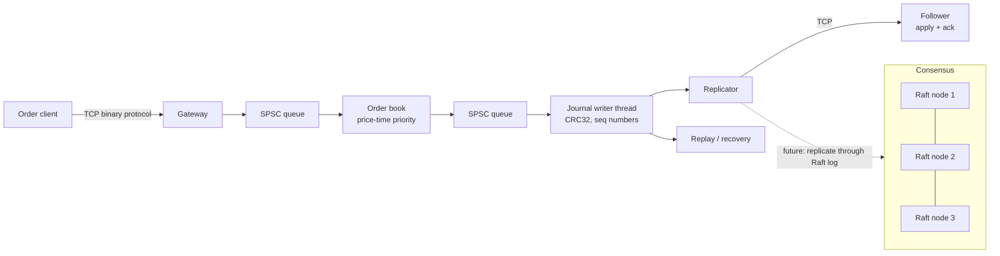

# Meridian

A matching engine in C++20, built the way a trading firm would build one: every component has a design doc, a deterministic test, a fuzzer or a simulator, and a write-up that separates what was measured from what is only a hypothesis.

Status: work in progress (month 1 of a 12-month plan). Everything here is free to build and run; no paid services.

## Architecture



| Component | What it is | Header / source |
|---|---|---|
| Wire protocol | Fixed binary messages, explicit endianness | `include/meridian/protocol.hpp` |
| Order book | Fixed pool, intrusive FIFO per level, open-addressing id map, 64-ary bitmap for best price | `order_book.hpp`, `price_bitmap.hpp` |
| SPSC queue | Lock-free ring, acquire/release, cached opposite index | `spsc_queue.hpp` |
| Journal and replay | 32-byte records, CRC32, sequence numbers, one shared `apply()` | `journal.hpp`, `replay.hpp` |
| Journal writer | Dedicated thread, group commit | `journal_writer.hpp` |
| Replication | Leader/follower, batched cumulative acks, ack-before-apply | `replication.hpp` |
| Raft election | Pure state machine plus a seeded cluster simulator | `raft_node.hpp`, `raft_sim.hpp` |

## Design decisions and tradeoffs

1. **Bitmap for best price instead of a scan or `std::map`.** A 64-ary bitmap finds the best price in a few word operations. Cost: memory proportional to the price range and a bounded tick grid. See `docs/bugs/007`.
2. **Fixed pool and intrusive lists, no heap on the book's hot path (intent).** Predictable latency, cache-friendly. Cost: a hard capacity limit. The "no allocation" claim is not yet proven by a test.
3. **SPSC queue instead of a mutex queue.** Compared in `docs/bugs/009`. Cost: exactly one producer and one consumer; fan-in needs a different design.
4. **Event sourcing with one shared `apply()`.** Live path and replay path run the same code, and an order-sensitive digest detects divergence. Cost: the journal format becomes a compatibility surface.
5. **Replication acks before apply and never beyond the first invalid record.** Cost: a follower can lag the leader's applied state. See `docs/bugs/013`.
6. **Raft as a pure state machine.** No clock, sockets or threads inside the node, so a deterministic simulator can inject loss, duplication, reordering, crashes and partitions from one seed. Cost: an I/O layer must be written later.
7. **Open-loop load generation.** Latency is measured from the intended send time to avoid coordinated omission.

## Testing approach

1. Unit tests for every component, including endianness and protocol edge cases.
2. Differential fuzzing of the order book against a `std::map` reference, with invariant checks.
3. ASan, UBSan and TSan runs.
4. Journal truncation, corruption and gap detection tests.
5. Raft: invariants checked after every simulated event, thousands of chaos seeds, liveness after healing, determinism, and mutation tests (five injected bugs, all caught).
6. A claim counts only after at least 3 runs. Anything else is labelled a hypothesis. See `docs/methodology.md`.

## Measurements

All numbers so far come from WSL2. They are valid for comparing variants against each other on this machine; they are **not** valid as absolute latency or durability claims.

1. Best-price lookup on a sparse book: bitmap p50 20.1 ns / p99 21.6 ns, versus a linear scan at p50 26,478 ns / p99 57,844 ns (`docs/bugs/007`).
2. `fdatasync` on WSL2 has p50 0.4 µs, so it is effectively a no-op there. Any "durable commit" latency from this environment is meaningless (`docs/bugs/012`).
3. Raft election: 3600 chaos seeds, 0 safety violations (`docs/bugs/014`).

Full tables, with p50/p99/p99.9 per benchmark, are in the write-ups under `docs/bugs/`.

## Not established yet

1. Bimodal SPSC throughput: unexplained.
2. Cause of the ~450 ns tail (likely cache-missing loads, possibly WSL2 nested paging): unverified.
3. Millisecond-scale stalls: unexplained.
4. Durability and tuning claims: need bare-metal Linux.
5. Allocation-free hot path: no proof test yet.
6. Sustained (not burst) throughput: not measured.

## Build and test

```bash
cmake -S . -B build -DCMAKE_BUILD_TYPE=Release
cmake --build build -j
ctest --test-dir build --output-on-failure
```

Sanitizer example:

```bash
g++ -std=c++20 -O1 -g -fsanitize=address,undefined -Iinclude -o /tmp/t tests/test_raft_election.cpp && /tmp/t
```

## Roadmap

1. Raft log replication and commit, then pre-vote and CheckQuorum
2. Order types (IOC, FOK, stop), modify
3. Snapshots and crash recovery
4. UDP market-data publisher and gateway hardening
5. Risk checks and order management
6. Profiling with `perf`, flamegraphs and cachegrind, with a measured speedup
7. Market-maker bot and backtester
8. Latency dashboard
9. Bare-metal Linux re-measurement

## Write-ups

Every experiment, bug and correction is in `docs/bugs/` (001 to 014), including the ones where an earlier claim turned out to be wrong.
